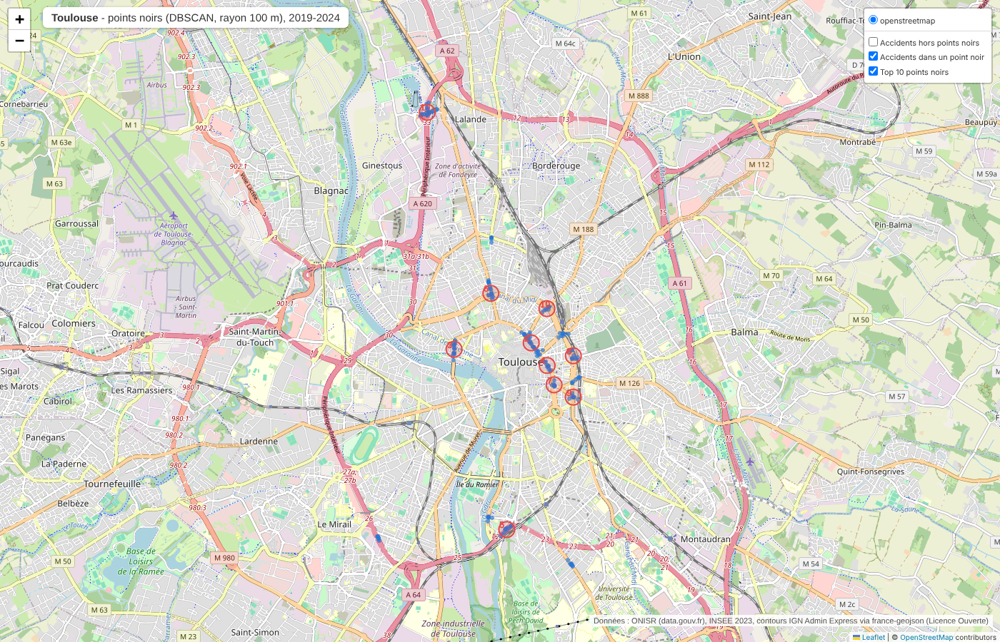
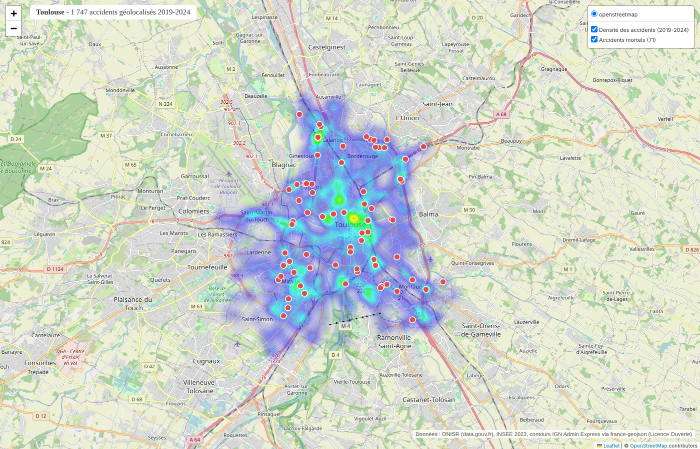
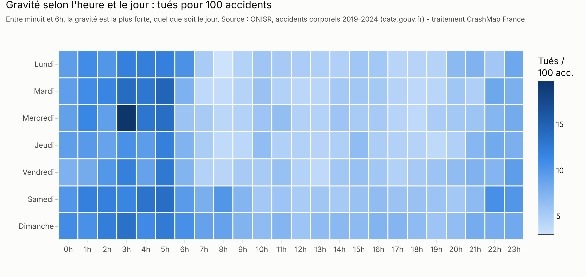
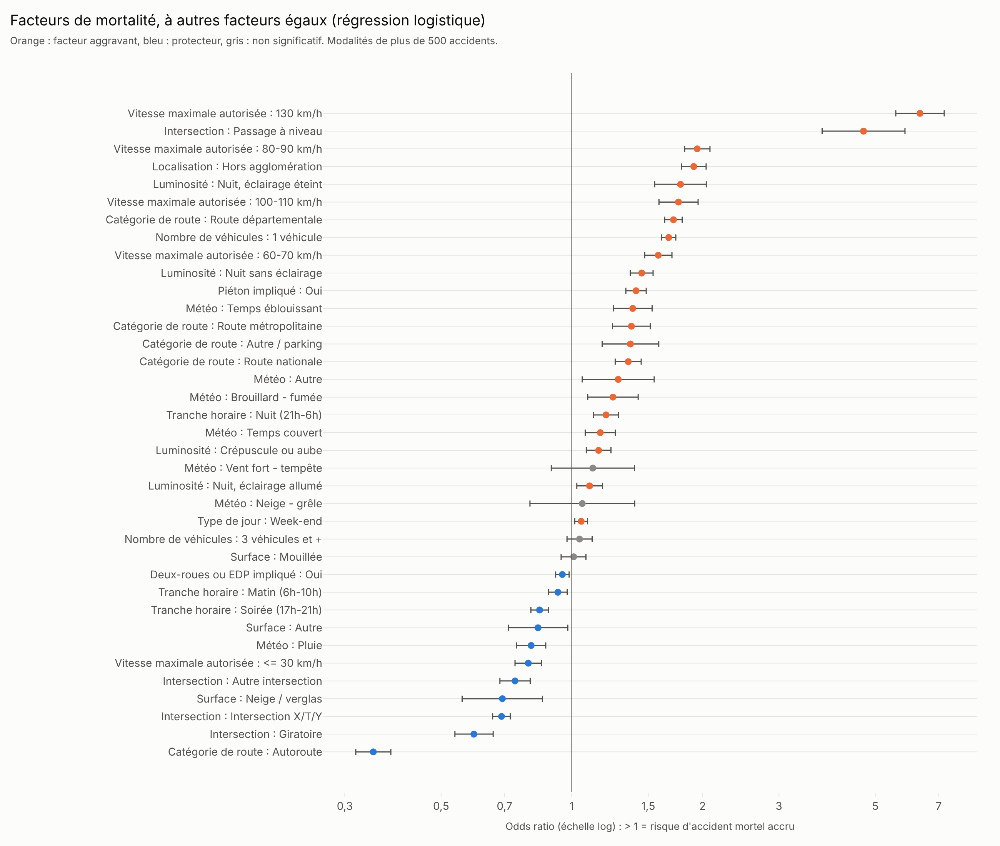
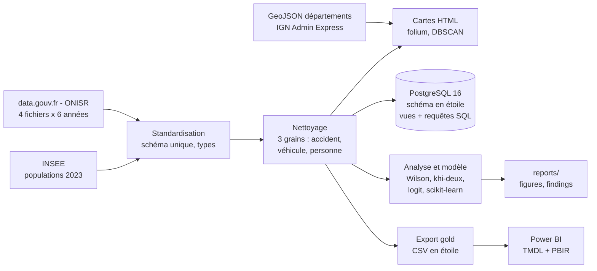

# CrashMap France

**Où, quand et dans quelles conditions se produisent les accidents de la route les plus graves en
France ? Analyse de 327 628 accidents corporels (2019-2024, données ONISR), du téléchargement des
fichiers bruts jusqu'au tableau de bord Power BI.**


## Question métier

Je me place comme analyste pour un observatoire de la sécurité routière ou un assureur :
**où, quand et dans quelles conditions surviennent les accidents les plus graves, et quels facteurs
rendent un accident plus grave ?** L'objectif est de dire où, quand et pour qui la prévention aurait
le plus d'impact.

Sept questions, chacune traitée en SQL et en Python :

1. **Quand** : heure, jour, mois. Les accidents de nuit sont-ils plus meurtriers ?
2. **Où** : taux pour 100 000 habitants par département, tués pour 100 accidents, en ou hors
   agglomération, points noirs d'une grande ville (Toulouse).
3. **Conditions** : luminosité, météo, chaussée, type de route, vitesse autorisée, intersection.
4. **Qui** : type d'usager, véhicule, âge, sexe, effet de la ceinture et du casque.
5. **Facteurs de gravité** : lesquels augmentent le plus la probabilité d'un accident mortel ?
6. **Tendance** : 2019 à 2024, avec 2020 (COVID) traité comme une anomalie.
7. **Recommandations**.

## Résultats clés

* **Hors agglomération : 36 % des accidents, 67 % des tués.** 11,2 tués pour 100 accidents contre
  3,1 en ville (×3,6). À autres facteurs égaux, la cote d'un accident mortel y est multipliée par
  1,9.
* **La nuit (21h-6h) : 16,5 % des accidents, 26,1 % des tués.** 9,6 tués pour 100 accidents contre
  5,5 en journée. Sans éclairage public, 13,5 % des accidents sont mortels, contre 4,9 % en plein
  jour.
* **La vitesse autorisée est le premier facteur de gravité** (V de Cramér 0,163). Par rapport à une
  route à 40-50 km/h, la cote d'un accident mortel est multipliée par 1,9 à 80-90 km/h, à
  autres facteurs égaux. Les routes départementales concentrent 11 558 des 19 877 tués.
* **Usagers vulnérables** : les deux-roues motorisés représentent 23,4 % des tués et les piétons
  14,7 %. 78 % des tués sont des hommes. Parmi les 75 ans et plus impliqués, 8,5 % sont tués,
  contre 2,0 % chez les 25-34 ans.
* **Ceinture** : 6,9 % des conducteurs de voiture sans ceinture sont tués, contre 1,7 % avec (risque
  ×4,1). C'est une association, pas une preuve de causalité : l'absence de ceinture va souvent avec
  d'autres comportements à risque.
* **Pas de baisse depuis 2019** : 3 432 tués en 2024 (-1,9 % par rapport à 2019) pour 7,5 % d'accidents
  en moins, donc des accidents plus graves en moyenne. Les tués en trottinette électrique et autres
  EDP passent de 10 à 46. Les totaux annuels de tués sont identiques aux bilans officiels de l'ONISR.

Détail, intervalles de confiance et limites : [`reports/findings.md`](reports/findings.md).

| Points noirs à Toulouse (DBSCAN, rayon 100 m) | Densité et accidents mortels à Toulouse |
|---|---|
|  |  |

Cartes interactives : [`reports/maps/`](reports/maps/) (fichiers HTML à télécharger et ouvrir dans
un navigateur).

### Tableau de bord Power BI

*Captures à venir* : `reports/figures/dashboard_1_vue_ensemble.png`,
`dashboard_2_carte.png`, `dashboard_3_quand.png`, `dashboard_4_conditions.png`,
`dashboard_5_qui.png`.

<!--


-->

| | |
|---|---|
|  |  |

## Recommandations

* **Où** : le réseau secondaire hors agglomération (routes départementales à 80-90 km/h :
  traitement des sorties de route et des obstacles latéraux, contrôle des vitesses), en priorité
  dans les départements ruraux au plus fort taux par habitant (Haute-Corse, Haute-Marne, Nièvre,
  Yonne, Jura : 8,8 à 9,5 tués pour 100 000 habitants par an) et en Guadeloupe et en Guyane. Les
  passages à niveau, rares mais très graves.
* **Quand** : les nuits, surtout de minuit à 6h et le week-end (alcool, vitesse, éclairage des
  zones non éclairées).
* **Pour qui** : les motards, les seniors (piétons et conducteurs), les hommes de 18 à 24 ans, les
  cyclistes et les utilisateurs de trottinettes électriques, et le port de la ceinture par les
  passagers.

## Données et méthode

* **Sources** : les 4 fichiers annuels de l'ONISR (caractéristiques, lieux, véhicules, usagers),
  2019 à 2024, téléchargés via l'API data.gouv.fr, plus les populations de référence 2023 de l'INSEE.
  La structure a changé en 2019 : les années antérieures sont exclues.
* **Jointures entre 4 tables et piège du double comptage** : un accident a plusieurs véhicules,
  chaque véhicule plusieurs usagers. La jointure complète compte 745 158 lignes pour 327 628
  accidents (×2,27). Le projet construit trois grains séparés (accident, véhicule, personne) en
  agrégeant toujours vers l'accident. Des tests vérifient que les accidents et les tués sont
  identiques quel que soit le grain utilisé.
* **Codes `-1`** et zéros « non renseigné » convertis en valeurs nulles, jamais en catégorie ;
  tous les codes décodés en libellés français d'après le PDF officiel.
* **Différences entre années** standardisées : clé `Accident_Id` en 2022, `id_usager` absent en
  2019-2020, espaces insécables dans les identifiants, départements sans zéro en 2019, coordonnées
  à virgule, plusieurs lignes `lieux` par accident depuis 2023 (on garde la voie principale).
* **Statistiques** : intervalles de Wilson, khi-deux et V de Cramér, régression logistique
  (rapports de cotes), contrôle prédictif scikit-learn (test sur 2024 : ROC AUC 0,78), DBSCAN pour
  les points noirs. Aucun taux n'est affiché sous 100 accidents.
* Contrôles : 58 tests unitaires, résultats SQL et Python identiques, totaux conformes aux bilans
  ONISR.

Détails : [`docs/methodology.md`](docs/methodology.md), [`docs/cleaning_report.md`](docs/cleaning_report.md),
[`docs/data_dictionary.md`](docs/data_dictionary.md), [`docs/sql_python_crosscheck.md`](docs/sql_python_crosscheck.md).

## Architecture



## Stack technique

Python 3.11+ (pandas, numpy, pyarrow, SQLAlchemy, psycopg, scipy, statsmodels, scikit-learn,
plotly + kaleido, folium, PyYAML, requests, pytest) · PostgreSQL 16 (Docker) · Power BI Desktop
(projet `.pbip`, modèle TMDL, rapport PBIR, thème personnalisé) · Make / `run.py`.

## Lancer le projet

```bash
git clone https://github.com/Oussama-essalehi/crashmap-france.git
cd crashmap-france
python -m venv .venv
source .venv/bin/activate            # Windows : .venv\Scripts\activate
pip install -r requirements.txt
cp .env.example .env                 # Windows : copy .env.example .env
docker compose up -d                 # PostgreSQL 16
python run.py all                    # ou : make all
```

`python run.py all` enchaîne `download`, `clean`, `test`, `load`, `analyze`, `maps` et `export`
(environ 5 minutes, dont le téléchargement d'environ 200 Mo). Chaque étape peut être lancée
seule (`python run.py clean`). Sans base PostgreSQL : `python run.py all --skip-load`. Les figures
PNG utilisent kaleido, qui a besoin de Chrome : lancer une fois `plotly_get_chrome` s'il n'est pas
installé.

**Power BI** : ouvrir `powerbi/CrashMapFrance.pbip`, renseigner le paramètre `DataFolder` avec le
chemin absolu de `data/gold`, puis actualiser. Le pas-à-pas complet, page par page, est dans
[`powerbi/BUILD_GUIDE.md`](powerbi/BUILD_GUIDE.md).

## Structure du dépôt

```
config.yaml          années, ville cible, seuils
run.py / Makefile    pipeline (download, clean, load, analyze, maps, export, test, all)
src/crashmap/        code Python (téléchargement, standardisation, nettoyage, SQL, analyse, cartes)
sql/                 schéma en étoile, vues, requêtes d'analyse
tests/               tests et petits fichiers CSV de test
notebooks/           exploration avec sorties
reports/             figures, cartes HTML, tables, résultats SQL, findings.md
powerbi/             projet Power BI (TMDL + PBIR), thème, guide de construction
docs/                méthodologie, rapport de nettoyage, dictionnaire de données
data/gold/           dimensions exportées (les faits, plus de 50 Mo, sont régénérés)
```

## Limites

* **Blessés hospitalisés** : non comparables avec les années antérieures à 2018 et plus labellisés
  par l'autorité de la statistique publique depuis 2019. Le nombre de **tués** reste l'indicateur
  principal.
* **Géolocalisation** : tous les accidents ne sont pas localisés précisément. 48 coordonnées hors du
  territoire ont été écartées, et 3 641 accidents partagent un même point (artefact de géocodage),
  exclus des cartes de densité.
* **Données personnelles occultées** dans les fichiers publics. Depuis 2021, les usagers en fuite
  apparaissent sans sexe, âge ni toujours gravité.
* **Pas de données de trafic** : les taux sont rapportés au nombre d'habitants, pas aux kilomètres
  parcourus. Un département rural très traversé paraît plus dangereux par habitant.
* **Population 2023** utilisée pour toutes les années. Mayotte et trois collectivités d'outre-mer
  n'ont pas de population de référence dans le fichier INSEE : leurs taux par habitant sont vides.
* **Corrélation n'est pas causalité** : les rapports de cotes et les écarts liés à l'équipement
  décrivent des associations. La vitesse réelle et l'alcool ne sont pas dans les données ouvertes.

## Sources et licences

* **ONISR**, « Bases de données annuelles des accidents corporels de la circulation routière »,
  [data.gouv.fr](https://www.data.gouv.fr/datasets/bases-de-donnees-annuelles-des-accidents-corporels-de-la-circulation-routiere-annees-de-2005-a-2024),
  Licence Ouverte / Open Licence (Etalab). Bilans annuels :
  [onisr.securite-routiere.gouv.fr](https://www.onisr.securite-routiere.gouv.fr/).
* **INSEE**, [Populations de référence 2023](https://www.insee.fr/fr/statistiques/8680726?sommaire=8681011),
  réutilisation libre avec mention de la source.
* **Contours des départements** : [france-geojson](https://github.com/gregoiredavid/france-geojson)
  (Grégoire David), dérivé d'IGN Admin Express, Licence Ouverte.
* **Fonds de carte** : © les contributeurs d'[OpenStreetMap](https://www.openstreetmap.org/copyright)
  (ODbL), via Leaflet.

## Contact

**Oussama Essalehi**,
[linkedin.com/in/oussama-essalehi](https://www.linkedin.com/in/oussama-essalehi) ·
[oussama-essalehi.dev](https://oussama-essalehi.dev)
