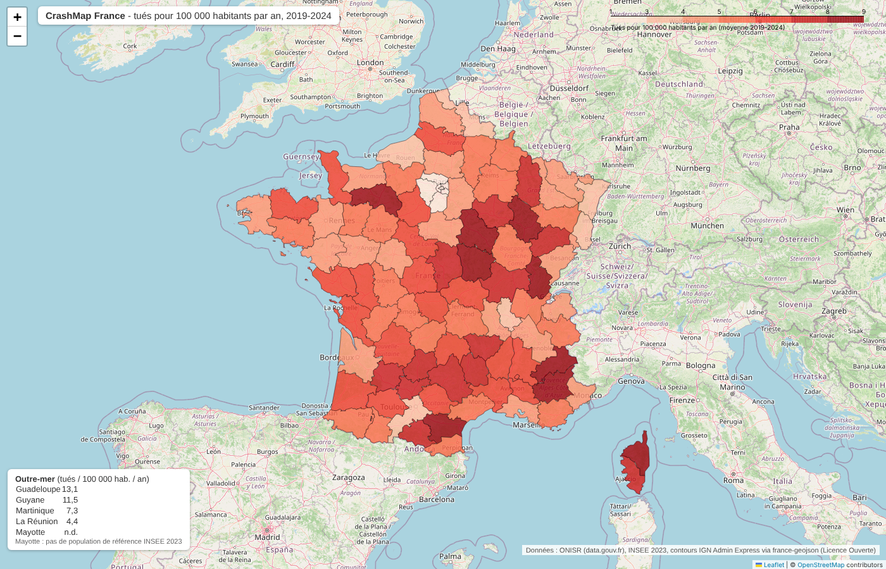
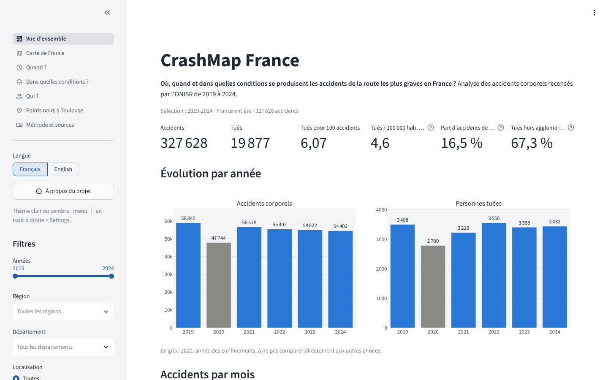
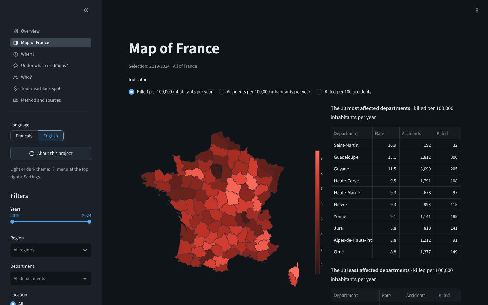
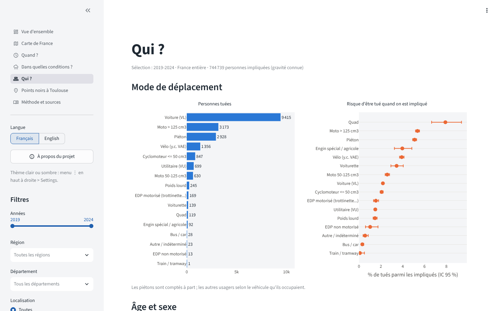
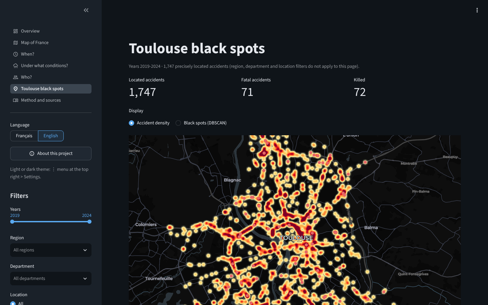

# CrashMap France

**Où, quand et dans quelles conditions se produisent les accidents de la route les plus graves en
France ?** Analyse de 327 628 accidents corporels de 2019 à 2024, à partir des données publiques de
l'ONISR.

**Application en ligne :** *lien à venir* · Disponible en français et en anglais, thème clair ou sombre.



## Le projet en bref

| | |
|---|---|
| **Question** | Où, quand et pour qui la prévention routière aurait-elle le plus d'impact ? |
| **Données** | 4 fichiers par an publiés par l'ONISR (accidents, lieux, véhicules, usagers), 2019-2024, et les populations INSEE |
| **Démarche** | Téléchargement automatique, nettoyage, base PostgreSQL, analyse statistique, cartes, application web |
| **Résultat** | Une application web interactive, des cartes, des chiffres vérifiés contre les bilans officiels |

## Ce qu'il faut retenir

* **Hors agglomération : 36 % des accidents mais 67 % des tués.** Un accident y est 3,6 fois plus
  souvent mortel qu'en ville.
* **La nuit (21h-6h) : 16,5 % des accidents mais 26 % des tués.** Sans éclairage public, 13,5 % des
  accidents sont mortels, contre 4,9 % en plein jour.
* **La vitesse autorisée est le premier facteur de gravité.** Les routes départementales concentrent
  11 558 des 19 877 tués.
* **Les plus exposés** : motards (23 % des tués), piétons (15 %), seniors. 78 % des tués sont des
  hommes. Sans ceinture, un conducteur de voiture a 4 fois plus de risque d'être tué.
* **Pas de baisse depuis 2019** : 3 432 tués en 2024 (-1,9 %), alors que le nombre d'accidents a
  baissé de 7,5 %. Les tués en trottinette électrique passent de 10 à 46.

Analyse complète, avec les intervalles de confiance et les limites :
[`reports/findings.md`](reports/findings.md).

## L'application web

Filtres par année, région, département et type de route ; carte de France, moments les plus à
risque, conditions, profils des victimes et points noirs à Toulouse.

| Vue d'ensemble | Carte de France (anglais, thème sombre) |
|---|---|
|  |  |
| **Qui sont les victimes ?** | **Points noirs à Toulouse** |
|  |  |

## Compétences mises en œuvre

| Domaine | Ce que j'ai fait |
|---|---|
| **Collecte** | Téléchargement automatique de 24 fichiers via l'API data.gouv.fr |
| **Nettoyage** | Harmonisation de 6 années aux formats différents, valeurs manquantes, codes traduits en libellés |
| **Modélisation** | Base PostgreSQL en schéma en étoile, éviter le double comptage entre 4 tables liées |
| **SQL** | Requêtes d'analyse (CTE, fonctions de fenêtre, ROLLUP), résultats identiques à Python |
| **Statistiques** | Intervalles de confiance, khi-deux, régression logistique, modèle prédictif (ROC AUC 0,78) |
| **Cartographie** | Cartes interactives, détection de points noirs par clustering (DBSCAN) |
| **Restitution** | Application web Streamlit bilingue, figures, rapport de résultats |
| **Qualité** | 112 tests automatisés ; totaux de tués identiques aux bilans officiels de l'ONISR |

**Outils** : Python (pandas, scikit-learn, statsmodels, plotly), PostgreSQL, SQL, Streamlit, Git.

## Lancer l'application

```bash
git clone https://github.com/Oussama-essalehi/CrashMap-France.git
cd CrashMap-France
pip install -r app/requirements.txt
streamlit run app/streamlit_app.py
```

L'application s'ouvre sur `http://localhost:8501`. Les données nécessaires sont incluses dans le dépôt.

Pour refaire tout le traitement depuis les fichiers bruts (environ 5 minutes) :
`pip install -r requirements.txt` puis `python run.py all --skip-load` (ou `python run.py all` avec
une base PostgreSQL, voir `docker-compose.yml`).

## Pour aller plus loin

* [Résultats détaillés](reports/findings.md)
* [Méthodologie](docs/methodology.md) et [rapport de nettoyage](docs/cleaning_report.md)
* [Dictionnaire de données](docs/data_dictionary.md)
* [Requêtes SQL](sql/03_analysis_queries.sql)
* [Cartes interactives](reports/maps/) (fichiers HTML à ouvrir dans un navigateur)

**Limites principales** : pas de données de trafic (les taux sont rapportés aux habitants, pas aux
kilomètres parcourus) ; la vitesse réelle et l'alcool ne figurent pas dans les données ouvertes ; les
résultats décrivent des associations, pas des causes.

## Sources

* **ONISR**, bases annuelles des accidents corporels de la circulation routière,
  [data.gouv.fr](https://www.data.gouv.fr/datasets/bases-de-donnees-annuelles-des-accidents-corporels-de-la-circulation-routiere-annees-de-2005-a-2024),
  Licence Ouverte (Etalab).
* **INSEE**, [populations de référence 2023](https://www.insee.fr/fr/statistiques/8680726?sommaire=8681011).
* **Contours des départements** : [france-geojson](https://github.com/gregoiredavid/france-geojson),
  Licence Ouverte. **Fonds de carte** : © les contributeurs
  d'[OpenStreetMap](https://www.openstreetmap.org/copyright).

## Contact

**Oussama Essalehi** ·
[LinkedIn](https://www.linkedin.com/in/oussama-essalehi) ·
[oussama-essalehi.dev](https://oussama-essalehi.dev)
